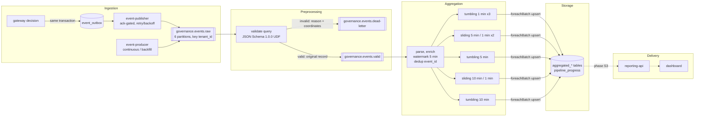

# Data flow

The data moves through five stages: ingestion, preprocessing, aggregation, storage and delivery. Implementation state:

| Stage | State |
|---|---|
| Ingestion (S1) | Implemented and verified |
| Preprocessing and aggregation (S2) | Implemented and verified |
| Storage (S2) | Implemented and verified |
| Delivery: reporting API and dashboard (S3) | Planned |

## 1. Ingestion

| Source | Path into Kafka | Event time |
|---|---|---|
| Gateway (real traffic) | `decide()` inserts the governance event into `event_outbox` in the decision's transaction. `event-publisher` sends due rows with `acks=all` and marks them published only after the ack | When the decision was made |
| `event-producer` (synthetic) | Writes directly to Kafka with `acks=all` and an idempotent producer | Continuous: now. Backfill: `--live` = production time; historical = spread over a span |

The event content is fixed by `schemas/governance_event/1.0.0.json`:
- Identifiers, enums, counts, scores and latencies only.
- No prompts, model output, entity values, credentials or redaction maps.
- `caller_id` is an HMAC pseudonym.

Messages are keyed by `tenant_id`, which keeps per-tenant ordering within a partition. Details: `docs/kafka.md`.

## 2. Preprocessing (`validate` query)

1. **Validate** each record with the JSON Schema validator the producers also use. Malformed JSON, missing or extra fields, wrong enums, bad UUIDs and non-UTC timestamps all fail.
2. **Route** each record by the result:
   - Valid: the record is copied unchanged (key, value, headers) to `governance.events.valid`.
   - Invalid: a value-free dead letter goes to `governance.events.dead-letter`, holding the reason, `event_id` if readable, the source partition and offset, the `run_id`, and the time it failed.
3. **Count** per micro-batch into `pipeline_progress`, and per producer run into `pipeline_run_counts`. Both are keyed by batch id, so a replay leaves the counts exact.

## 3. Aggregation (8 queries over `governance.events.valid`)

1. Parse into typed columns and convert the timestamp to an event-time column.
2. Enrich with indicator columns (`is_deny`, `is_injection`, `has_pii`, `is_failed`, `is_risky_destination`).
3. Set a 5-minute watermark and drop duplicate `event_id`s. This undoes at-least-once delivery from the outbox relay and from replays of the `validate` query.
4. Aggregate in tumbling and sliding event-time windows. The window choices are explained in `docs/aggregations.md`.

## 4. Storage

- Results go to seven `aggregated_*` tables in long format: one row per window, dimensions and metric, with the value, `event_count`, `query_name`, `batch_id` and `processed_at`.
- The primary key is (window, dimensions, metric). Spark's update output mode re-emits the current window value, and `INSERT … ON CONFLICT DO UPDATE` overwrites it. Replays after a restart are therefore idempotent and committed results are never lost.
- Writes use the least-privilege `stream_processor` role.

## 5. Delivery (phase S3, planned)

- A separate `reporting-api` (FastAPI) will read only the aggregate tables, through a read-only role. The tenant will always come from the JWT.
- It will expose `/v1/metrics/*` with time-range, tenant and agent filters and pagination.
- The React dashboard will poll it every 5 seconds.

## Verification

`scripts/verify_pipeline.py` (`make verify-pipeline`) checks the whole path at volume:

1. Produces N events (default 1,000,000) under a fresh run id and fresh tenants.
2. **Kills the Spark processor mid-run** and restarts it.
3. Waits for the pipeline to drain.
4. Checks:
   - produced = consumed = valid + dead-letter;
   - sum of each tumbling aggregation = valid events.

Results are recorded in `EVALUATION.md`.
