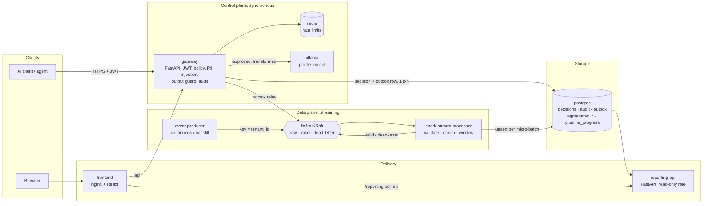
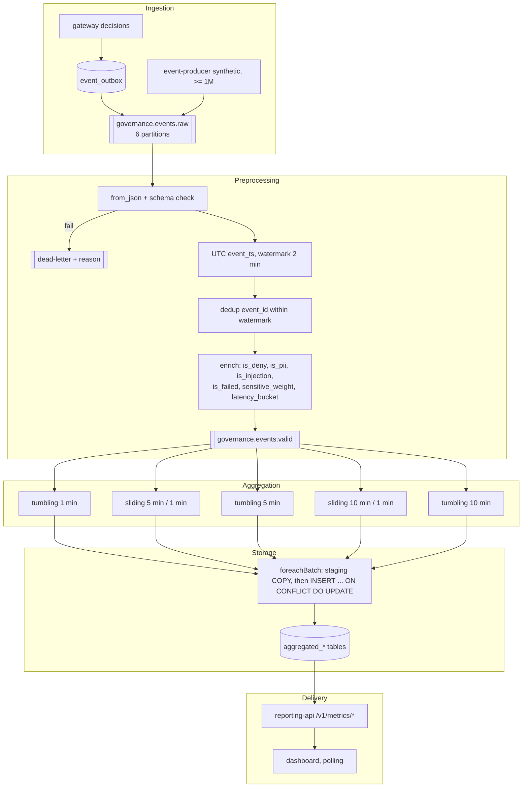

# Architecture after the refactor

**Status:** target design for review. Nothing in this document is implemented yet.

## 1. Architecture



## 2. Event flow (one governed request)

```mermaid
sequenceDiagram
  participant C as Client
  participant G as Gateway
  participant DB as Postgres
  participant RL as Outbox relay
  participant K as Kafka
  participant S as Spark
  participant A as Reporting API
  participant UI as Dashboard

  C->>G: POST /v1/ai/infer (JWT)
  G->>G: detect PII / injection, evaluate policy
  G->>DB: BEGIN; decision, detections, audit, agent_event, event_outbox; COMMIT
  G-->>C: decision (+ guarded model answer)
  RL->>DB: SELECT unpublished FOR UPDATE SKIP LOCKED
  RL->>K: produce governance.events.raw (key tenant_id, acks=all, idempotent)
  RL->>DB: mark published_at
  S->>K: read raw (micro-batch)
  S->>K: invalid to dead-letter, valid to valid
  S->>K: read valid
  S->>S: watermark 2 min, window, aggregate
  S->>DB: upsert aggregates (ON CONFLICT), then commit checkpoint
  UI->>A: GET /v1/metrics/overview (every 5 s)
  A->>DB: SELECT latest windows (tenant from JWT)
  A-->>UI: metrics + as_of + watermark
```

## 3. Data flow



**Field lineage**

| Category | Fields |
|---|---|
| Never leaves the gateway | Prompts, model answers, entity values, redaction maps, credentials |
| Leaves the gateway transformed | `caller_id`, as an HMAC-SHA256 with `CALLER_ID_HASH_KEY` |
| Leaves the gateway as-is | Everything else in the schema: ids, enums, counts, scores, latencies |

## 4. Service responsibility matrix

| Service | Owns | Reads | Writes | Port (host) | Runs as |
|---|---|---|---|---|---|
| gateway | Security decisions, audit chain, outbox relay | redis, postgres | postgres (app tables, outbox), kafka `raw` | 127.0.0.1:8000 | uid 10001 |
| event-producer | Synthetic telemetry | — | kafka `raw` | none | non-root |
| kafka | Durable buffer, ordering per partition | — | own log volume | none (internal only); 127.0.0.1:9094 only under profile `tools` | image default non-root |
| kafka-init | Topic definitions | — | kafka metadata | none | one-shot |
| spark-stream-processor | Validation, enrichment, windowing, upserts, checkpoints | kafka `raw`, `valid` | kafka `valid`, `dead-letter`; postgres aggregates (`processor_rw`) | none (health on internal network) | uid 185 (spark image) |
| postgres | System of record + aggregate store | — | — | 127.0.0.1:5432 | postgres |
| reporting-api | Read-only metrics delivery | postgres (`reporting_ro`) | — | 127.0.0.1:8001 | non-root |
| frontend | UI | gateway, reporting-api via nginx | — | 127.0.0.1:5173 | uid 101 |
| redis | Rate-limit counters | — | — | 127.0.0.1:6379 | redis |
| ollama (profile `model`) | Local LLM | — | — | 127.0.0.1:11434 | — |

## 5. Kafka topic design

| Topic | Partitions | Key | Why |
|---|---:|---|---|
| `governance.events.raw` | 6 | `tenant_id` | Per-tenant ordering. Six partitions allow up to six parallel Spark tasks and producer throughput headroom on a laptop |
| `governance.events.valid` | 6 | `tenant_id` (preserved) | Aggregation queries re-read clean data without re-validating. Also a replay point |
| `governance.events.dead-letter` | 1 | — | Low volume; ordering irrelevant. Value = original bytes (truncated to 16 KB) + `reason`, `query`, `batch_id`, `failed_at` |

**Why `tenant_id` and not `agent_id`:** `agent_id` is null for user and service callers, which would funnel them into one hot partition. Per-agent ordering isn't needed, because windows use event time, not arrival order.

**Producer settings:** `enable.idempotence=true`, `acks=all`, `linger.ms=20`, `compression=zstd`.

**Consumer semantics:** Spark tracks offsets in its checkpoint, not in Kafka's group offsets. The checkpoint is the source of truth for progress, and the `kafka-ui` lag view is informational only.

**Event value:** UTF-8 JSON conforming to `schemas/governance_event/1.0.0.json`. Kafka headers:
- `schema_version`
- `source` (`gateway` | `producer`)

## 6. Aggregation design

| # | Aggregation | Window | Group by | Table | Rationale |
|---|---|---|---|---|---|
| 1 | Requests per tenant | Tumbling 1 min | tenant | request_metrics | Load is reported per minute; non-overlapping, so sums equal the total event count, which is the reconciliation basis for the 1M check |
| 2 | Requests per agent | Tumbling 1 min | tenant, agent | request_metrics | Same; agent activity spikes are minute-scale |
| 3 | Decisions by type | Tumbling 1 min | tenant, decision | policy_metrics | Exact counts per period for security monitoring |
| 4 | Deny rate | Sliding 5 min / 1 min | tenant | policy_metrics | A rate needs enough events to be stable; sliding gives a fresh value every minute |
| 5 | Average latency | Sliding 5 min / 1 min | tenant | latency_metrics | Smooths single slow calls; updates every minute |
| 6 | P99 latency | Sliding 5 min / 1 min | tenant | latency_metrics | Tail latency needs ≥ ~100 samples to mean anything; 5 minutes provides that at demo rates |
| 7 | PII per model | Tumbling 5 min | tenant, destination_model | pii_metrics | Exposure reporting by period; PII is sparse, so 1 minute would be mostly zeros |
| 8 | Injection attempts per agent | Sliding 5 min / 1 min | tenant, agent | injection_metrics | Attacks come in bursts; overlap catches bursts that straddle a boundary |
| 9 | Agent anomaly score | Sliding 10 min / 1 min | tenant, agent | agent_risk_metrics | Matches the existing 10-minute feature window (`agents/features.py:12`), so the trained detector stays applicable |
| 10 | Sensitive volume by jurisdiction | Tumbling 10 min | tenant, jurisdiction, sensitivity | sovereignty_metrics | Sovereignty is reported for compliance periods; 10 minutes balances freshness against row count |
| 11 | Failed policy evaluations | Sliding 5 min / 1 min | tenant | policy_metrics | Reliability alerting needs a continuously updated rate |

**Watermark: 2 minutes.**
- It is longer than the producer's bounded disorder (≤ 60 s) and the outbox relay delay (seconds).
- It is short enough that windows finalise quickly.
- Events later than this are counted in `late_events_total` and are not aggregated.

**P99:** use `percentile_approx(latency_ms, 0.99, 1000)` if streaming support is confirmed on the pinned Spark version (step 6 spike). Otherwise, aggregate fixed latency-bucket counts in the stream and compute P99 in reporting-api.

**Anomaly score:** window features are computed in the stream: request count, deny count, PII events, tokens, distinct destinations, off-hours flag. Inside `foreachBatch` they are scored with the existing Isolation Forest model, **only if feature parity with `agents/features.py` is confirmed** (risk R-06). Otherwise, a documented z-score against a per-agent rolling baseline is used, and labelled as such.

## 7. Failure and recovery design

| Failure | Behaviour | Guarantee |
|---|---|---|
| Kafka down while the gateway serves requests | Decisions still commit; outbox rows accumulate; the relay retries with exponential backoff (max 30 s). Security decisions never depend on Kafka | No event loss (bounded by Postgres) |
| Relay crashes after producing, before marking published | Event re-sent on restart | At-least-once; duplicates removed by `dropDuplicatesWithinWatermark(event_id)` |
| Malformed event | Routed to dead-letter with a reason; does not stop the query | Poison-pill isolation |
| Spark processor killed mid-batch | On restart, Spark replays from the last committed offsets in the checkpoint. State store restores partial window aggregates. The re-run batch upserts the same keys | Upsert means no duplicates. Committed aggregates are never deleted |
| Postgres unavailable during a sink | `foreachBatch` raises, the query fails, the container restarts (`restart: unless-stopped`), and the batch is replayed from the checkpoint | At-least-once into an idempotent sink |
| Checkpoint volume lost | The processor starts from `startingOffsets=earliest` within retention and re-computes. Upsert overwrites with identical values | Recoverable within Kafka retention (7 days) |
| Reporting API down | Dashboard shows stale-data banner (`as_of` age > 30 s) | No impact on processing |
| Disk pressure | Topic `retention.bytes`, `MAXLEN`-style caps, alert at 80% volume use | Documented in runbook |

**Graceful shutdown:**
- Spark: on SIGTERM, `query.stop()` for each query.
- Producer: flush and close.
- Relay: finish the current batch.
- `stop_grace_period: 30s`.

**Alert rules** (`infra/monitoring/alerts.yml`):
- Consumer lag (latest offset minus processed offset) > 100k for 5 minutes
- Dead-letter rate > 1% for 5 minutes
- Outbox unpublished rows > 10k
- No progress batch for 2 minutes
- Deny rate > 50% for 10 minutes
- P99 > 2 s for 10 minutes

## 8. Security design

| Boundary | Control |
|---|---|
| Client → gateway | Unchanged: JWT, RBAC scopes, tenant check (`decisions.py:97`), rate limit, size limit, strict CORS, security headers. **Model and jurisdiction resolved from the `ai_assets` registry** (implementation-order step 9) |
| Gateway → Kafka | Internal Docker network only; no host port by default. Event content minimised by schema (`additionalProperties: false`); `metadata` key allow-list; `caller_id` HMAC. Kafka listener is PLAINTEXT locally, **documented as not production-ready**; the TLS/SASL configuration is written into `.env.example` as commented options (TLS-ready) |
| Kafka → Spark | Schema validation before any processing; DLQ payload truncated; no `eval` of event content |
| Spark → Postgres | `processor_rw` role: INSERT/UPDATE on aggregate tables only. Parameterised upserts (no string-built SQL) |
| Postgres → reporting-api | `reporting_ro` role: SELECT only. Tenant from the JWT, never from query params. Time ranges and page sizes bounded |
| reporting-api → browser | Same middleware as the gateway (shared module); aggregates only, never raw events. **Small-count suppression:** cells with `event_count < 5` for PII/sovereignty metrics are returned as `"<5"` to reduce re-identification |
| Supply chain | Images pinned by tag and digest; Spark connector jars downloaded at build time with sha256 verification; Trivy on all images in CI; `pip-audit` on producer and reporting requirements |
| Secrets | All from `.env` (gitignored). New keys: `CALLER_ID_HASH_KEY`, DB role passwords. `migrate` checks they are not `CHANGE_ME` outside dev |

## 9. How the 1,000,000-event requirement is verified (`scripts/verify_1m.py`)

1. **Start from empty:** truncate aggregates, use fresh checkpoints, and create new topics (or record the starting offsets).
2. **Backfill 1,000,000 valid events** with a fixed seed. Event times span a simulated period, with disorder ≤ 60 s.
3. **Simulate a crash:** at about 40% progress (read from `pipeline_progress`), `docker compose kill spark-stream-processor`, then `docker compose start spark-stream-processor`.
4. **Wait for the pipeline to drain:** offsets processed = end offsets, and the watermark is past the last event plus the window size.
5. **Reconcile:**

| Reported line | Source |
|---|---|
| Produced | Producer acked count, and the sum of end-offset deltas on `raw` |
| Consumed | Sum of `numInputRows` for `q_validate` in `pipeline_progress` (may exceed 1M after the restart replay, which is expected) |
| Valid | Sum of end-offset deltas on `valid`, minus duplicates |
| Aggregated | `SELECT sum(value) FROM aggregated_request_metrics WHERE metric='requests' AND agent_id = <all-sentinel>`. Tumbling windows count each event exactly once |
| Dead-letter | End-offset delta on `dead-letter` |
| Restart recovery | PASSED only if aggregated = produced − dead-letter **and** there are no duplicate primary keys (guaranteed by PK) **and** the restart happened mid-run |

6. **Separate run with failure injection on** (for example 0.5%): asserts dead-letter = injected invalid count and aggregated = produced − invalid − late.

The script prints the summary in the brief's format, using the **actual measured** numbers, and exits non-zero on any mismatch. Throughput and lag go into `EVALUATION.md` only from a real run.
