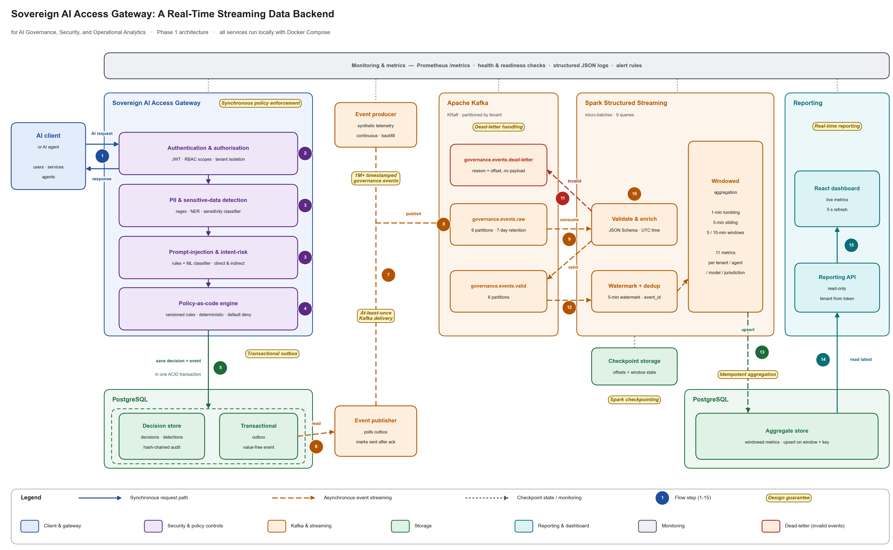

# Architecture notes: Phase 1

*Sovereign AI Access Gateway: A Real-Time Streaming Data Backend for AI Governance, Security, and Operational Analytics.* The diagram is rendered by `architecture_diagram.py` in this folder. The numbers below match the numbered steps in the diagram.

## 1. Purpose

Organisations route AI requests through the gateway, which enforces security and data-protection policy before anything reaches a model. Every decision becomes a timestamped **governance event**.

The system is a **real-time streaming data backend**: it continuously ingests those events, processes and aggregates them in event-time windows, stores the results and serves them to a live dashboard. The synchronous gateway is the event source; the streaming pipeline is the data product.

## 2. Main components

| Layer | Components |
|---|---|
| Client and gateway | AI client / AI agent; Sovereign AI Access Gateway (FastAPI) |
| Security and policy controls | Authentication and authorisation; PII and sensitive-data detection; prompt-injection and intent-risk classification; policy-as-code engine |
| Kafka and streaming | Event publisher; event producer (synthetic load); Apache Kafka (KRaft) with `governance.events.raw`, `.valid` and `.dead-letter`; Spark Structured Streaming processor |
| Storage | PostgreSQL: decision store, transactional outbox and aggregate store (one database, separate least-privilege roles); Spark checkpoint storage |
| Reporting | Real-time reporting API (read-only); React dashboard |
| Monitoring | Prometheus metrics, health and readiness checks, structured JSON logs, alert rules |

## 3. Request flow (synchronous, solid arrows)

1. An AI client or agent sends a request to the gateway.
2. The gateway authenticates the caller (JWT), checks its scopes (RBAC) and binds it to its tenant.
3. Detection runs over the prompt and attachments: PII and sensitive data, then prompt-injection and intent risk.
4. The policy-as-code engine evaluates versioned rules (default deny): allow, redact or pseudonymise, route, review, deny or quarantine.
5. The decision, its audit record and a value-free governance event are saved **in one database transaction** (decision store plus transactional outbox). The caller receives the decision and, if approved, the guarded model answer.

## 4. Event flow (asynchronous, dashed arrows)

6. The event publisher reads unpublished outbox rows.
7. It publishes them to Kafka with `acks=all`, and marks a row as sent only after Kafka acknowledges it. The event producer publishes synthetic events the same way, used for load and the 1M+ event backfills.
8. Kafka stores every event in `governance.events.raw`.
9. Spark consumes the raw topic.
10. Spark validates each event against the versioned JSON Schema, parses UTC timestamps and adds derived fields.
11. Invalid events go to `governance.events.dead-letter`, with a reason and source offset but never the payload.
12. Valid events go to `governance.events.valid`. They are then watermarked (5 minutes), deduplicated by `event_id`, and aggregated in time windows.
13. Aggregates are upserted into PostgreSQL.
14. The reporting API reads the latest aggregates.
15. The dashboard displays the live metrics, refreshing every 5 seconds.

## 5. Kafka design

| Aspect | Design |
|---|---|
| Broker | Single KRaft broker, no ZooKeeper; internal network only |
| Topics | `raw` and `valid` have 6 partitions; `dead-letter` has 1. Each has time and size retention |
| Message key | `tenant_id`, which preserves per-tenant order |
| Format | JSON matching the versioned schema `governance_event/1.0.0`; `schema_version` and `source` headers |
| Delivery | **At-least-once**: idempotent producers with `acks=all`; duplicates are removed downstream by `event_id` |

## 6. Spark processing design

Spark 3.5 Structured Streaming runs in local mode as micro-batches.

- **Queries:** one validation query (raw → valid / dead-letter), plus eight aggregation queries over the valid topic.
- **Checkpointing:** each query keeps its own checkpoint (Kafka offsets plus RocksDB window and dedup state) on a Docker volume, so a restarted processor resumes where it stopped.

## 7. Aggregation design

There are 11 metrics, computed by 8 queries.

| Window | Metrics |
|---|---|
| **1-minute tumbling** | Requests per tenant and per agent; decisions by type |
| **5-minute sliding (1-minute slide)** | Deny rate, average and P99 latency, failed evaluations, injection attempts per agent |
| 5-minute tumbling | PII per destination model |
| 10-minute sliding | Agent risk score |
| 10-minute tumbling | Sensitive-data volume by jurisdiction |

Why these windows:
- Tumbling windows count each event exactly once, which allows reconciliation: the sum over the 1-minute windows equals the number of valid events.
- Sliding windows give rates and percentiles that refresh every minute.

Events later than the watermark are counted and exported as a metric, never silently ignored.

## 8. Storage design

PostgreSQL holds three things:
- the **decision store** (decisions, detections, and a per-tenant hash-chained audit trail);
- the **transactional outbox**;
- the **aggregate store**.

Aggregate tables are long-format, with one row per window, dimensions and metric. Their primary key makes writes **idempotent upserts**, so a batch replayed after a crash overwrites the same rows instead of double counting.

Each service connects with its own least-privilege role. Configurable retention removes old data in an order that keeps foreign keys and the audit chain intact.

## 9. Reporting design

The reporting API is a separate, read-only FastAPI service. It requires the `audit:read` scope and takes the tenant only from the token. It offers time-range and agent filters, keyset pagination, and small-cell suppression for PII and sovereignty metrics.

The React dashboard polls it every 5 seconds through same-origin nginx, which allows only GET.

## 10. Reliability design

- **Outbox:** prevents losing or inventing events between the database and Kafka.
- **Publisher:** retries with exponential backoff and is gated on Kafka's acknowledgement.
- **Dead-letter topic:** malformed events are isolated instead of stopping the pipeline.
- **Restart recovery:** Spark checkpoints, `event_id` deduplication and idempotent upserts. Verified with a 1,000,000-event run in which the processor was killed mid-run: produced = consumed = aggregated.
- **Operations:** every service has health checks, a restart policy and graceful shutdown.

## 11. Security and governance design

| Concern | Control |
|---|---|
| Access | JWT authentication, RBAC scopes, tenant isolation at every layer |
| Policy | Policy-as-code: versioned, validated, deterministic, default deny |
| Detection | PII, sensitive-data and prompt-injection detection before forwarding; output guardrails on model answers |
| Audit | Tamper-evident, hash-chained audit trail |
| Data minimisation | Events and dead letters carry no prompts, answers, entity values or credentials; caller IDs and content fingerprints are keyed HMACs |
| Least privilege | Per-service database roles; secrets only from the environment, validated at start |
| Scanning | CI runs Bandit, Semgrep, pip-audit, npm audit and Trivy |

These are technical controls that support governance and data-protection requirements. They are not a compliance certification.

## 12. Known limitations

- **Single host:** one Kafka broker (replication factor 1) and Spark in local mode. Scaling was demonstrated locally, not on a cluster. In the experiment, the Spark process was the throughput bottleneck.
- **No encryption locally:** traffic between containers and the data volumes aren't encrypted. TLS, SASL and encryption at rest are documented production requirements.
- **Spark's bundled Java libraries** carry known vulnerabilities. They are reported and mitigated; the remediation path is Spark 4.
- **Model registry:** the gateway still takes the destination model and jurisdiction from the request. A trusted registry lookup is planned.
- **Agent risk score:** the stream-level score is a transparent heuristic, not the gateway's trained Isolation Forest.
- **Evidence:** performance figures come from single runs on one machine (`EVALUATION.md`).
