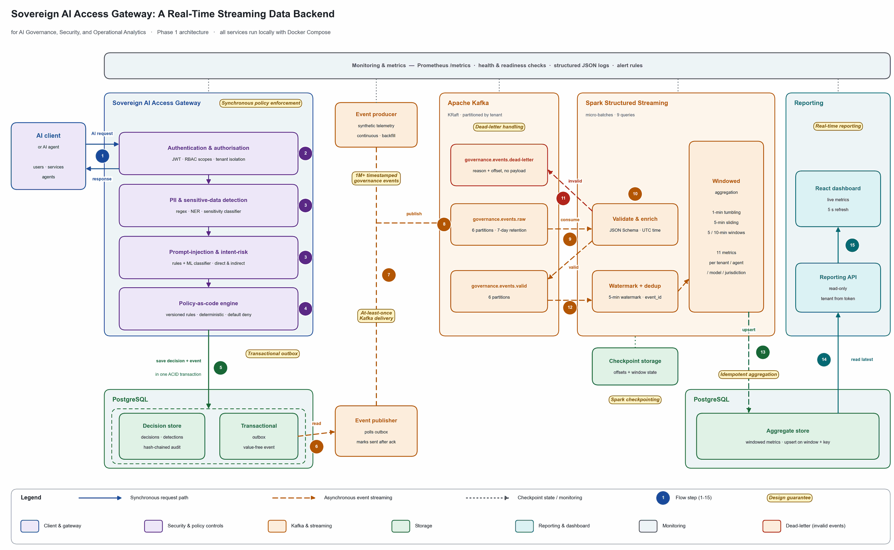

# Phase 1: Conception

**Course:** DLMDSEDE02 Data Engineering · **Task 2:** real-time data backend for a data-intensive application

**Submission date:** _[fill in]_

## Title

**Sovereign AI Access Gateway: A Real-Time Streaming Data Backend for AI Governance, Security, and Operational Analytics**

## Concept text for PebblePad (225 words, excluding the title)

Problem and objective: European organisations increasingly use AI systems and autonomous agents but must keep sensitive data away from unapproved models, endpoints and jurisdictions, and prove that policies were enforced. This project builds a real-time streaming data backend that ingests AI-governance events, processes and aggregates them, and delivers live security and operational metrics.

Architecture: A FastAPI gateway authenticates callers, isolates tenants, detects sensitive data and prompt injection, and enforces policy-as-code. Each decision is stored with an event in a transactional outbox; a separate publisher delivers it to Apache Kafka, chosen for durable, partitioned, replayable buffering. Spark Structured Streaming, chosen for event-time windows, watermarks and checkpointed recovery, validates and enriches events and computes one-minute tumbling and five-minute sliding aggregations. PostgreSQL stores the results; a reporting API serves them to a React dashboard.

Data and reliability: A producer generates over 1,000,000 timestamped events. At-least-once delivery, deduplication, idempotent writes, checkpointing, retries and a dead-letter topic provide reliability; partitioning supports scaling.

Procedure and tools: Gateway first, then ingestion, processing and delivery, each verified by tests. Isolated Docker microservices, Docker Compose, versioned migrations and Git keep it reproducible and maintainable.

Security and governance: JWT, role-based access control, tenant isolation, least-privilege accounts, data minimisation, retention controls and tamper-evident audit records.

Advantages and disadvantages: real-time, auditable visibility and reproducible deployment, at the cost of operational complexity and tuning windows, thresholds and resources.

## Architecture draft

## Explanatory remarks

The architecture separates synchronous AI-security enforcement from asynchronous real-time analytics.

The gateway authenticates requests, detects sensitive data and prompt-injection risk, evaluates policy-as-code rules, and stores each decision with an outbox event in one transaction. A separate publisher delivers events to Kafka.

Kafka buffers and distributes governance events. Spark Structured Streaming validates, enriches, and aggregates the stream using one-minute tumbling and five-minute sliding windows. Aggregated metrics are stored in PostgreSQL and delivered through a real-time reporting API to the React dashboard.

Invalid events are routed to a dead-letter topic. Checkpointing enables recovery after processor failure. Tenant isolation, policy-as-code enforcement, data minimisation, and audit records support security and governance.

---

## Preparation notes (not part of the submission)

### Phase 1 checklist

| Question | Answered by |
|---|---|
| What problem, what aim, why relevant? | "Problem and objective" |
| Which services ingest, process, aggregate and deliver? | Gateway, outbox and publisher → Kafka → Spark → PostgreSQL → reporting API → dashboard |
| Why Kafka? Why Spark? | "chosen for durable, partitioned, replayable buffering" / "chosen for event-time windows, watermarks and checkpointed recovery" |
| Which windows and aggregations? | One-minute tumbling and five-minute sliding (diagram: 11 metrics) |
| How do you reach 1M+ events? | Producer generates over 1,000,000 timestamped events |
| Reliability, scalability, maintainability? | "Data and reliability", "Procedure and tools" |
| Security, governance, protection? | "Security and governance" |
| Git, Infrastructure as Code, Docker microservices? | "Procedure and tools" |
| How will you proceed? | "Gateway first, then ingestion, processing and delivery, each verified by tests" |
| Advantages and disadvantages? | Last paragraph |

### Differences from the draft text supplied on 2026-11-08

The supplied draft was 237 words and did not cover six required points. The version above covers them in 225 words:
- why Kafka;
- why Spark;
- Git and Infrastructure as Code;
- Docker microservices;
- maintainability;
- the procedure.

It also replaces "Kafka consumer groups" with an accurate description: Spark Structured Streaming tracks Kafka offsets in its own checkpoints, not through committed consumer-group offsets. If you prefer the original wording, change only that phrase.

### Files to upload

| File | Content | Naming |
|---|---|---|
| Concept text | The 225-word text above, pasted into PebblePad | - |
| Architecture PNG | `docs/portfolio/architecture-submission.png` (2600 × 1603 px, about 146 KB) | Rename to the required pattern, e.g. `Surname-FirstName12345678DataEngineeringP1S.png`, using your own surname, first name and matriculation number (check the exact pattern in the assignment PDF) |
| Remarks | The "Explanatory remarks" above, below or beside the PNG | - |

The full-resolution diagram (`architecture.png`, 4500 px) and its source (`architecture_diagram.py`) stay in the repository. Regenerate both PNGs with `python docs/portfolio/architecture_diagram.py`.

### Deliberately not included (concept phase)

Source code, API documentation, threat model, test results, evaluation, implementation status, screenshots, extra diagrams, production-readiness claims, and claims of legal compliance.
